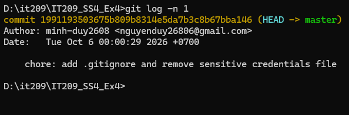

1. Bối cảnh bài toán
   Trong lúc làm việc, tôi đã lỡ git add . và commit nhầm file credentials.txt (chứa thông tin bảo mật như mật khẩu, API key) lên Git. Yêu cầu:

Gỡ credentials.txt khỏi sự theo dõi của Git mà không xóa file vật lý trên đĩa.
Cấu hình .gitignore để Git tự động bỏ qua file này trong tương lai.
Sửa lại thông điệp commit gần nhất cho sạch sẽ bằng --amend.
Ràng buộc: không dùng lệnh xóa file của hệ điều hành (del, rm) — file phải còn nguyên trong thư mục làm việc cục bộ.

2. Các lệnh đã thực hiện
# 1) Commit "nhầm" chứa credentials.txt (thông điệp cẩu thả cần sửa sau)
git add .
git commit -m "update"

# 2) Tạo file .gitignore (nội dung xem mục 3)

# 3) Gỡ credentials.txt khỏi cache theo dõi, GIỮ NGUYÊN file vật lý
git rm --cached credentials.txt

# 4) Đưa .gitignore vào staging
git add .gitignore

# 5) Sửa lại thông điệp commit gần nhất
git commit --amend -m "chore: them .gitignore va go credentials.txt khoi git tracking"
3. Nội dung file .gitignore
# ===== File nhay cam (bi mat) =====
credentials.txt
*.env
.env
*.key
*.pem

# ===== File rac he thong =====
Thumbs.db
desktop.ini
.DS_Store

# ===== Thu muc dependencies / build =====
node_modules/
dist/
build/

# ===== Log =====
*.log
npm-debug.log*
4. Giải thích cơ chế
   4.1. git rm --cached — gỡ khỏi cache, giữ file vật lý
   git rm credentials.txt sẽ xóa cả file trên đĩa lẫn khỏi Git → vi phạm ràng buộc.
   git rm --cached credentials.txt chỉ gỡ file khỏi Staging Index (cache theo dõi của Git), còn file trên đĩa cứng vẫn còn nguyên.
   Điểm mấu chốt: cờ --cached (đồng nghĩa --staged) báo cho Git thao tác chỉ trên index. Sau lệnh, file chuyển sang trạng thái deleted (staged) — Git sẽ ghi nhận việc ngừng theo dõi file này ở commit kế tiếp, nhưng bản thân file không bị đụng chạm trên ổ đĩa.

Minh chứng file vẫn tồn tại sau khi gỡ khỏi cache:

$ git rm --cached credentials.txt
rm 'credentials.txt'

$ Test-Path credentials.txt   # (PowerShell) kiểm tra file vật lý
True
4.2. .gitignore — tự động bỏ qua trong tương lai
Việc git rm --cached chỉ có tác dụng một lần: nếu không có .gitignore, lần sau chạy git add . Git sẽ lại "nhìn thấy" credentials.txt và đưa nó trở lại theo dõi. Vì vậy ta thêm dòng credentials.txt vào .gitignore để Git chủ động bỏ qua file này.

Kiểm tra quy tắc ignore đang áp dụng:

$ git check-ignore -v credentials.txt
.gitignore:2:credentials.txt   credentials.txt
→ Xác nhận credentials.txt khớp với quy tắc ở dòng 2 của .gitignore và đang bị bỏ qua.

4.3. git commit --amend — sửa commit gần nhất
--amend cho phép viết lại commit cuối cùng: kết hợp các thay đổi đang ở staging (việc xóa credentials.txt khỏi index, thêm .gitignore) vào commit gần nhất và thay thế thông điệp cũ. Commit cũ bị thay bằng một commit mới (mã hash đổi), nên chỉ nên dùng với commit chưa được push lên remote để tránh ảnh hưởng người khác.

5. Kết quả kiểm tra
   5.1. git status — file không còn trong danh sách theo dõi
   $ git status
   On branch main
   nothing to commit, working tree clean
   → credentials.txt không còn xuất hiện ở dạng Staged hay Modified (cũng không hiện là Untracked vì đã được .gitignore bỏ qua). Cây làm việc sạch.

Danh sách file Git đang theo dõi (không còn credentials.txt):

    update
Sau khi amend (thông điệp mới, hash thay đổi):

$ git log -n 1
commit 1991193503675b809b8314e5da7b3c8b67bba146 (HEAD -> master)
Author: minh-duy2608 <nguyenduy26806@gmail.com>
Date:   Tue Oct 6 00:00:29 2026 +0700

    chore: them .gitignore va go credentials.txt khoi git tracking

