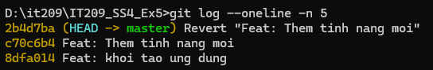

1. Bối cảnh bài toán
Tôi đã tạo ra một commit chứa mã nguồn bị lỗi ở local. Bài thực hành xử lý sai sót này bằng hai kỹ thuật khác nhau:

Trường hợp	Kỹ thuật	Mục đích
1. Sửa đổi cục bộ	git reset	Lùi lịch sử local 1 commit, giữ thay đổi ở Working Directory để viết lại code
2. Sửa đổi công cộng	git revert	Đảo ngược một commit đã đẩy lên remote, tạo commit mới ghi lại việc đảo ngược
Ràng buộc: Trường hợp 1 không được dùng reset --hard (không làm mất mã nguồn); Trường hợp 2 bắt buộc phải sinh ra một commit mới.

2. Lịch sử commit ban đầu
Trước khi xử lý, nhánh main có 3 commit, commit cuối chứa lỗi (hàm subtract trả về a + b thay vì a - b):

c00c367 feat: them ham subtract (co loi)   <-- commit loi
dd037e2 feat: them ham add
07d689e chore: khoi tao du an
3. Trường hợp 1 — Sửa đổi cục bộ bằng git reset
Mục tiêu: lùi con trỏ HEAD 1 commit nhưng không làm mất code — các thay đổi được giữ lại trong Working Directory ở dạng Modified (chưa staged) để có thể viết lại.

git reset HEAD~1        # tương đương: git reset --mixed HEAD~1
Lưu ý: đây là --mixed (chế độ mặc định của reset), không phải --hard. Cờ --hard sẽ xóa luôn nội dung thay đổi trong Working Directory — vi phạm ràng buộc của bài.

Kết quả — git status (thay đổi nằm ở dạng Modified, chưa staged):

On branch main
Changes not staged for commit:
  (use "git add <file>..." to update what will be committed)
  (use "git restore <file>..." to discard changes in working directory)
	modified:   app.js

no changes added to commit (use "git add" and/or "git commit -a")
Kết quả — git log --oneline -n 5 (HEAD đã lùi lại, commit lỗi biến mất khỏi lịch sử):

dd037e2 feat: them ham add
07d689e chore: khoi tao du an
Đối chiếu bằng git diff --stat để chứng minh code vẫn còn nguyên trong Working Directory:

 app.js | 4 ++++
 1 file changed, 4 insertions(+)
→ Sau git reset HEAD~1: HEAD lùi 1 commit, commit lỗi không còn trong lịch sử, nhưng mã nguồn vẫn nằm trong Working Directory dưới dạng Modified → toàn quyền sửa rồi commit lại.

4. Trường hợp 2 — Sửa đổi công cộng bằng git revert
Mục tiêu: đảo ngược thay đổi của commit lỗi bằng cách tạo thêm một commit mới đối lập, an toàn khi nhánh đã được đẩy lên remote và chia sẻ với người khác.

Giả lập commit lỗi đã nằm trong lịch sử dùng chung:

git add app.js
git commit -m "feat: them ham subtract (co loi)"   # 94e673e
94e673e feat: them ham subtract (co loi)
dd037e2 feat: them ham add
07d689e chore: khoi tao du an
Đảo ngược commit lỗi bằng git revert:

git revert HEAD --no-edit
Kết quả — commit revert mới được tạo (tiêu đề bắt đầu bằng Revert ...):

[main fbc8503] Revert "feat: them ham subtract (co loi)"
 1 file changed, 4 deletions(-)
Kết quả — git log --oneline -n 5 (commit Revert nằm trên đầu nhánh):

fbc8503 Revert "feat: them ham subtract (co loi)"   <-- commit dao nguoc moi
94e673e feat: them ham subtract (co loi)
dd037e2 feat: them ham add
07d689e chore: khoi tao du an
Kết quả — git status (cây làm việc sạch):

On branch main
nothing to commit, working tree clean
→ git revert không xóa commit cũ — nó tạo commit mới đối lập để phủ định thay đổi, nhờ đó lịch sử vẫn toàn vẹn và có thể push lên nhánh chung mà không phá lịch sử của người khác.

 Hình minh chứng
(Dán ảnh chụp màn hình kết quả git log --oneline -n 5 cho thấy commit Revert ... trên đầu nhánh vào đây.)

5. So sánh reset và revert
5.1. Ba chế độ của git reset
Chế độ	HEAD (lịch sử)	Staging Index	Working Directory	Dùng khi
--soft	Lùi	Giữ nguyên (đã staged)	Giữ nguyên	Muốn gộp lại commit, giữ nguyên stage
--mixed (mặc định)	Lùi	Đặt lại (unstaged)	Giữ nguyên	Trường hợp 1 của bài — viết lại code
--hard	Lùi	Đặt lại	Xóa sạch 	Hủy bỏ hoàn toàn, mất code
5.2. Khác biệt cốt lõi
Tiêu chí	git reset	git revert
Tác động lên lịch sử	Viết lại / xóa commit (đổi hash)	Giữ nguyên, thêm commit mới đối lập
Commit mới được tạo?	Không	Có (Revert "...")
Có làm mất code?	Có thể (nếu --hard)	Không
An toàn khi đã push?	 Không — phải push --force, phá lịch sử người khác	✅ Có — push thường, an toàn
Phạm vi phù hợp	Cá nhân / commit chưa push	Nhóm / commit đã push
6. Khi làm việc cá nhân so với làm việc nhóm trên nhánh chung
Làm việc cá nhân (local): commit chưa được push, chỉ mình tôi có → dùng git reset để viết lại lịch sử cho gọn, đúng như Trường hợp 1. Vì không ai khác đã kéo commit đó về, việc đổi hash không ảnh hưởng tới ai.

Làm việc nhóm (nhánh chung, đã push): commit đã public, đồng nghiệp đã pull về → tuyệt đối không dùng reset (sẽ buộc phải push --force, khiến lịch sử của người khác lệch và dễ gây mất code của họ). Thay vào đó dùng git revert để đảo ngược một cách công khai bằng commit mới, giống Trường hợp 2. Nguyên tắc vàng:

Reset để sửa lịch sử riêng của mình — Revert để sửa lịch sử đã chia sẻ với người khác.

